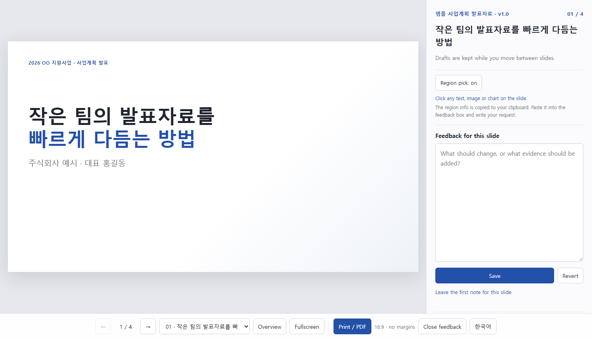

# html-deck-review

[한국어](README.md) · **English**

> **This is not a tool for making IR decks. It is a tool for reviewing an IR deck you already have, collecting feedback on it, and turning that feedback into the next version.**

Once a pitch deck, business plan or presentation exists as HTML, most of the remaining work is review. Founders, co-founders, mentors and investors send comments, and each round of comments becomes a new version.
In practice those comments end up scattered across chat and email, reviewers have to describe locations in words (“the right-hand number in the second table on page 3”), and it quickly gets unclear which version a comment was about.

html-deck-review is a [Claude Code](https://claude.com/claude-code) skill for that review loop.
It leaves your deck's design and content untouched and adds only a **per-slide feedback panel** and a **bottom toolbar** on top.
Reviewers' notes are collected in one JSON file per deck version, and Claude applies the notes for that version only to produce the next version file.



## What it does, and what it doesn't

| Does | Doesn't |
|---|---|
| Adds a feedback panel and toolbar to an existing HTML deck | Create a deck from scratch |
| Lets reviewers click a region on a slide and comment on it | Change the deck's design or theme |
| Collects and merges feedback JSON per deck version | Plan content or write the storyline |
| Builds the next version from that version's feedback only | Rewrite slides without reviewer input |
| Checks for overflow/clipping, prints a 16:9 vector PDF | Convert to PPTX |

Build your deck however you like: by hand, with another skill, or with an AI generator. Any HTML file with one `class="slide"` element per slide can be reviewed with this skill.

## The review loop

```
deck_v1.0.html ──review──▶ deck_v1.0_feedback.json ──apply──▶ deck_v1.1.html ──review──▶ deck_v1.1_feedback.json ──▶ …
```

1. **Install the shell**: write a new version of your deck with the feedback panel and toolbar added. The original design does not change.
2. **Review**: reviewers open the HTML file in a browser, click what should change, write a note and save. No server, no account.
3. **Send**: reviewers send back `deck_v1.0_feedback.json`. Files for the same version from several reviewers are merged automatically.
4. **Apply**: ask Claude to “apply the v1.0 feedback”. It builds `deck_v1.1.html` from that version's notes only and runs the layout check.
5. **Review again**: the new version opens with an empty panel, so old notes never mix with new ones.

## Features

| Feature | Description |
|---|---|
| Feedback panel | A note per slide · autosaved in the browser · saved to a JSON file (Chrome/Edge keep updating the same file) · JSON/TXT export · import and merge · clear all |
| Region pick | Click any text, image or chart on a slide to copy its selector, current content and original coordinates to the clipboard. No more describing *where* to edit |
| Version-scoped feedback | Each HTML version gets its own feedback file (`deck_v1.1_feedback.json`). A new version starts with an empty panel, and an update applies only that version's notes |
| Toolbar | ← → · jump to slide · overview · fullscreen (F) · print/PDF (16:9 or A4, borderless vector) · show/hide feedback · language switch |
| Korean / English | The review tools come in Korean and English. Reviewers can switch with the `EN` / `한국어` button in the toolbar |
| Layout check | Headless Chrome finds elements that spill outside a slide and text that gets clipped |
| PDF | Produces the same output as the on-screen print button, from the command line |

The deck stays a single HTML file, and feedback lives only in the reviewer's browser and the JSON file. Nothing is sent to any server.

## Language

The review tools (feedback panel, toolbar and region info) are available in Korean and English. The deck content itself is never translated.

| Option | What it does |
|---|---|
| Default `--lang auto` | Follows the deck's `<html lang>`; if there is none, follows the browser language (Korean → Korean, anything else → English) |
| `--lang en` / `--lang ko` | Sets the language the deck opens in. Use `--lang en` for decks going to English-speaking reviewers |
| `EN` / `한국어` toolbar button | Reviewers switch on the spot. Drafts are kept, and the choice is remembered per deck in the browser |
| Link `deck_v1.0.html?lang=en` | Sets the language through the link. Takes precedence over everything else |
| `--no-lang-switch` | Hides the switch and locks the UI to the chosen language |

The feedback JSON format is the same in both languages, so notes from Korean- and English-speaking reviewers on the same version are merged and applied together.

## Install

### As a Claude Code plugin

```
/plugin marketplace add algorhythmkr/html-deck-review
/plugin install html-deck-review@html-deck-review
```

### By copying the skill folder

```bash
git clone https://github.com/algorhythmkr/html-deck-review
cp -r html-deck-review/skills/deck-review ~/.claude/skills/      # for your user
# or for one project only: <project>/.claude/skills/deck-review
```

Requirements: Python 3.9+ (standard library only) and Chrome / Edge / Chromium for the layout check and PDF.
If the browser is not found automatically, set `DECK_REVIEW_BROWSER` to its executable path.

## Usage

Two sentences in Claude Code are all you need.

**1. Once: turn your deck into a review copy with the skill**

```
Rebuild IR_v1.0.html with the /deck-review skill
```

The feedback panel and toolbar are added to your existing deck. Send this file to your reviewers; they open it in a browser, leave notes and save them as `IR_v1.0_feedback.json`. Put the returned JSON in the same folder as the HTML.

**2. Apply the feedback**

```
Apply the feedback to IR_v1.0.html and update it
```

A new version, **`IR_v1.1.html`**, is created from the v1.0 notes only. It already includes the feedback panel, so you can send it straight back to your reviewers.

**From then on, repeat the same sentence.**

You only call the `/deck-review` skill once. After every review round, just repeat the line below and the deck moves on to v1.2, v1.3 and so on.

```
Apply the feedback and update it
```

## Using it with your own deck

The deck contract is short:

1. One element with `class="slide"` per slide (the selector is configurable)
2. Slides are laid out at a fixed size (1280×720 by default)
3. Ideally, a meaningful and stable key such as `data-slide-key="market-size"`. Feedback is stored under this key

Full contract and settings: [`skills/deck-review/references/deck-contract.md`](skills/deck-review/references/deck-contract.md)
Feedback JSON format: [`skills/deck-review/references/feedback-format.md`](skills/deck-review/references/feedback-format.md)

> The skill's own instructions (`SKILL.md`, `references/`) are written in Korean. Claude reads them fine and answers in your language, so English-speaking users can use the skill as is.

## Layout

```
.claude-plugin/            plugin and marketplace manifests
skills/deck-review/
  SKILL.md                 the procedure Claude follows
  assets/                  shell runtime (review-shell.css / .js), inlined into the deck
  scripts/                 apply_shell · feedback_report · check_deck · export_pdf
  references/              deck contract · feedback format · editing guide
examples/                  a deck without the shell, and the installed result
```

## Author and copyright

- Author: Jaemin Cho
- Copyright: © 2026 Algorhythm Inc.
- Contact: [contact@algorhythm.kr](mailto:contact@algorhythm.kr)

## License

MIT License. See [LICENSE](LICENSE) for the full text.
