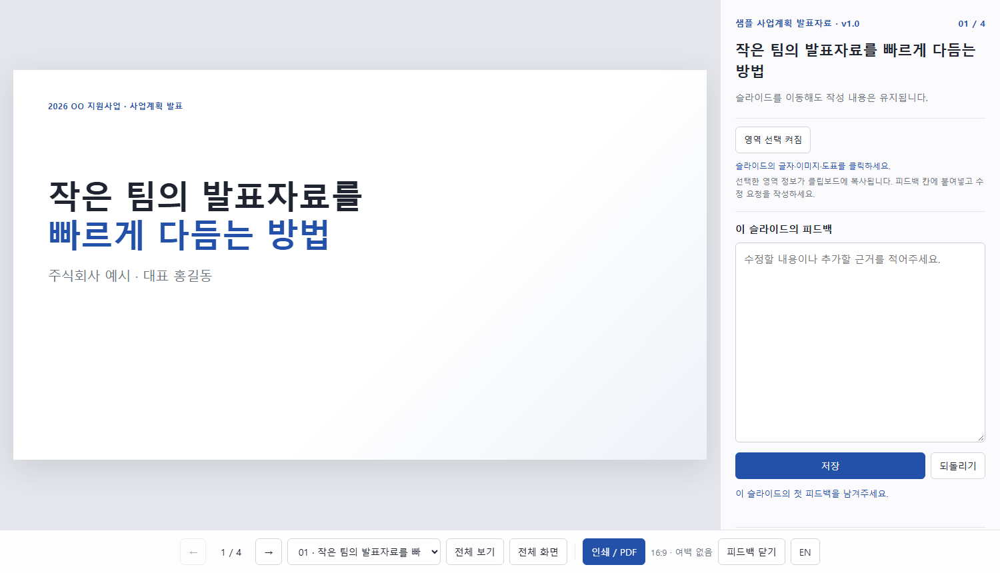

# html-deck-review

**한국어** · [English](README.en.md)

> **IR 덱을 만드는 도구가 아닙니다. 이미 만든 IR 덱을 검토하고, 피드백을 주고받고, 그 피드백을 다음 버전에 반영하는 도구입니다.**

IR 자료·사업계획서·발표자료를 HTML로 만들었다면, 그다음 일은 대부분 검토입니다. 대표, 공동창업자, 멘토, 투자 심사역이 의견을 주고, 그 의견을 반영한 다음 버전을 다시 돌려 봅니다.
그런데 의견은 보통 메신저와 메일에 흩어지고, “3페이지 두 번째 표의 오른쪽 숫자”처럼 위치를 말로 설명해야 하며, 어느 버전에 대한 의견인지도 금방 섞입니다.

html-deck-review는 이 검토 과정을 맡는 [Claude Code](https://claude.com/claude-code) 스킬입니다.
덱의 디자인과 내용은 그대로 두고, 그 위에 **슬라이드별 피드백 창**과 **하단 메뉴**만 덧씌웁니다.
검토자가 남긴 의견은 버전별 JSON 파일로 모이고, Claude가 그 버전의 의견만 읽어서 다음 버전 파일을 만듭니다.



## 이 스킬이 하는 일과 하지 않는 일

| 하는 일 | 하지 않는 일 |
|---|---|
| 기존 HTML 덱에 피드백 창·하단 메뉴 설치 | 덱을 처음부터 만들기 |
| 검토자가 슬라이드의 특정 영역을 클릭해 의견 남기기 | 덱 디자인·테마 바꾸기 |
| 버전별 피드백 JSON 수집·병합 | 내용 기획, 스토리라인 작성 |
| 그 버전의 의견만 반영한 다음 버전 파일 생성 | 검토자 의견 없이 임의로 고치기 |
| 넘침·잘림 검수, 16:9 벡터 PDF 출력 | PPTX 변환 |

덱 제작은 어떤 도구로 해도 됩니다(직접 작성, 다른 스킬, AI 생성 등). 슬라이드마다 `class="slide"` 요소가 있는 HTML 파일이면 이 스킬로 검토할 수 있습니다.

## 검토 흐름

```
덱_v1.0.html ──검토──▶ 덱_v1.0_feedback.json ──반영──▶ 덱_v1.1.html ──검토──▶ 덱_v1.1_feedback.json ──▶ …
```

1. **셸 설치**: 기존 덱에 피드백 창과 하단 메뉴를 넣은 새 버전 파일을 만듭니다. 원본 디자인은 바뀌지 않습니다.
2. **검토**: 검토자는 HTML 파일을 브라우저로 열고, 고칠 곳을 클릭한 뒤 의견을 적고 저장합니다. 서버나 계정이 필요 없습니다.
3. **전달**: 검토자는 저장된 `덱_v1.0_feedback.json`을 보내 줍니다. 여러 명이 보낸 같은 버전 파일은 자동으로 합쳐집니다.
4. **반영**: Claude에게 “v1.0 피드백 반영해줘”라고 요청하면, 그 버전 의견만으로 `덱_v1.1.html`을 만들고 검수까지 마칩니다.
5. **재검토**: 새 버전은 빈 피드백 창으로 시작하므로, 이전 의견과 섞이지 않습니다.

## 기능

| 기능 | 설명 |
|---|---|
| 피드백 창 | 슬라이드마다 의견 작성 · 브라우저 자동 보관 · JSON 파일 저장(Chrome/Edge는 같은 파일을 계속 갱신) · JSON/TXT 내보내기 · 불러와 병합 · 전체 삭제 |
| 영역 선택 | 슬라이드의 글자·이미지·도표를 클릭하면 선택자·현재 내용·원본 좌표가 클립보드에 복사됩니다. “어디를 고칠지” 말로 설명할 필요가 없습니다 |
| 버전별 피드백 | HTML 버전마다 피드백 파일이 따로 생깁니다(`덱_v1.1_feedback.json`). 새 버전은 빈 피드백 창으로 시작하고, 업데이트할 때는 그 버전 피드백만 반영합니다 |
| 하단 메뉴 | ← → · 슬라이드 목록 이동 · 전체 보기 · 전체 화면(F) · 인쇄/PDF(16:9 또는 A4, 여백 없는 벡터) · 피드백 열기/닫기 · 언어 전환 |
| 한국어 / 영어 | 검토 도구 문구를 한국어와 영어 중에서 고를 수 있습니다. 하단 메뉴의 `EN` / `한국어` 버튼으로 검토자가 직접 바꿀 수 있습니다 |
| 검수 | headless Chrome으로 슬라이드 밖으로 나간 요소와 잘린 글자를 찾습니다 |
| PDF | 화면의 인쇄 버튼과 같은 결과를 명령줄에서 생성합니다 |

덱은 HTML 파일 하나로 유지되고, 피드백은 검토자의 브라우저와 JSON 파일에만 저장됩니다. 외부 서버로 아무것도 전송하지 않습니다.

## 언어 설정

검토 도구(피드백 창·하단 메뉴·영역 정보)의 문구는 한국어와 영어를 지원합니다. 덱 본문은 번역하지 않습니다.

| 방법 | 설명 |
|---|---|
| 기본값 `--lang auto` | 덱의 `<html lang>`을 따릅니다. `lang` 속성이 없으면 브라우저 언어를 따릅니다(한국어 → 한국어, 그 외 → 영어) |
| `--lang en` / `--lang ko` | 처음 열 때의 언어를 지정합니다. 해외 투자자에게 보내는 덱이면 `--lang en`을 쓰세요 |
| 하단 메뉴 `EN` / `한국어` 버튼 | 검토자가 화면에서 바로 바꿉니다. 작성 중인 의견은 유지되고, 선택은 브라우저에 덱별로 기억됩니다 |
| 링크 `덱_v1.0.html?lang=en` | 링크로 언어를 지정합니다. 가장 우선합니다 |
| `--no-lang-switch` | 전환 버튼을 숨기고 지정한 언어로 고정합니다 |

언어를 바꿔도 피드백 JSON 형식은 같습니다. 한국어 검토자와 영어 검토자가 같은 버전에 남긴 의견도 한 번에 합쳐서 반영합니다.

## 설치

### Claude Code 플러그인으로

```
/plugin marketplace add algorhythmkr/html-deck-review
/plugin install html-deck-review@html-deck-review
```

### 스킬 폴더만 복사

```bash
git clone https://github.com/algorhythmkr/html-deck-review
cp -r html-deck-review/skills/deck-review ~/.claude/skills/      # 사용자 전체
# 또는 특정 프로젝트에만: <프로젝트>/.claude/skills/deck-review
```

요구 사항: Python 3.9+(표준 라이브러리만 사용), 검수·PDF용 Chrome / Edge / Chromium.
브라우저를 자동으로 찾지 못하면 `DECK_REVIEW_BROWSER` 환경 변수에 실행 파일 경로를 지정하세요.

## 사용법

Claude Code에서 이렇게 요청하면 됩니다.

- “`IR_v1.0.html`에 피드백 창이랑 하단 메뉴 넣어줘”
- “영어 검토자한테 보낼 거니까 피드백 창을 영어로 넣어줘”
- “`IR_v1.0_feedback.json` 반영해서 v1.1로 수정해줘”
- “이 덱 PDF로 뽑고 넘치는 곳 있는지 검수해줘”

스크립트를 직접 쓸 수도 있습니다.

```bash
S=skills/deck-review/scripts

# 1) 기존 덱에 셸 설치 (새 버전 파일로 출력, 재실행 안전)
python $S/apply_shell.py examples/sample-deck.html -o examples/sample-deck_v1.0.html --deck-id sample-deck
#    영어로 시작하려면 --lang en, 전환 버튼을 숨기려면 --no-lang-switch

# 2) 검토자가 v1.0을 열어 의견을 쓰고 저장 → sample-deck_v1.0_feedback.json

# 3) v1.0 피드백만으로 수정 작업 목록 생성 (같은 폴더의 v1.0 JSON 자동 사용, 다른 버전 JSON은 거부)
python $S/feedback_report.py examples/sample-deck_v1.0.html

# 4) v1.0을 sample-deck_v1.1.html로 복사해 수정한 뒤 셸 갱신 → 피드백 창이 빈 v1.1
python $S/apply_shell.py sample-deck_v1.1.html --in-place
#    검토자는 v1.1에서 새로 의견을 쓰고 sample-deck_v1.1_feedback.json으로 저장

# 5) 검수와 PDF
python $S/check_deck.py sample-deck_v1.1.html
python $S/export_pdf.py sample-deck_v1.1.html -o sample-deck_v1.1.pdf
```

## 내 덱에 쓰려면

덱이 지켜야 할 규약은 짧습니다.

1. 슬라이드마다 `class="slide"` 요소 하나 (선택자는 바꿀 수 있습니다)
2. 슬라이드는 고정 크기(기본 1280×720) 기준으로 배치
3. 가능하면 `data-slide-key="market-size"`처럼 의미 있는 고정 키를 붙입니다. 피드백이 이 키로 저장됩니다

전체 규약과 설정 항목: [`skills/deck-review/references/deck-contract.md`](skills/deck-review/references/deck-contract.md)
피드백 JSON 형식: [`skills/deck-review/references/feedback-format.md`](skills/deck-review/references/feedback-format.md)

## 구성

```
.claude-plugin/            플러그인·마켓플레이스 매니페스트
skills/deck-review/
  SKILL.md                 Claude가 따르는 작업 절차
  assets/                  셸 런타임 (review-shell.css / .js), 덱에 인라인으로 삽입됨
  scripts/                 apply_shell · feedback_report · check_deck · export_pdf
  references/              덱 규약 · 피드백 형식 · 수정 원칙
examples/                  셸 없는 원본과 설치 결과
```

## 라이선스

MIT
